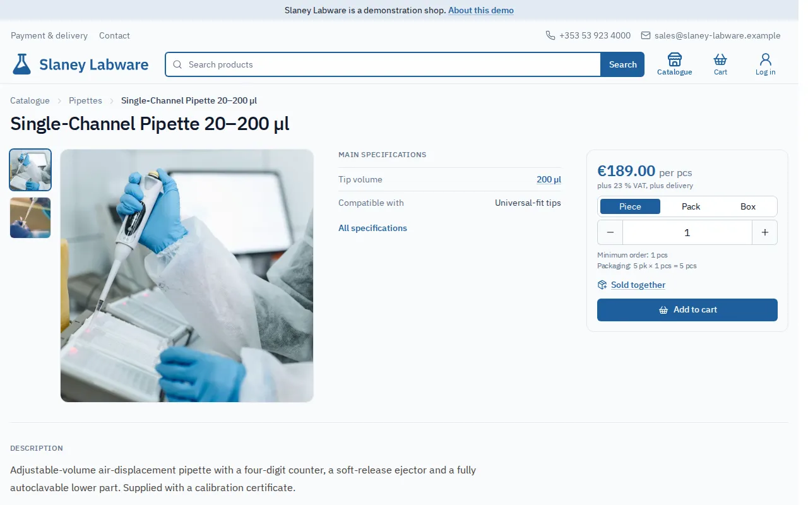
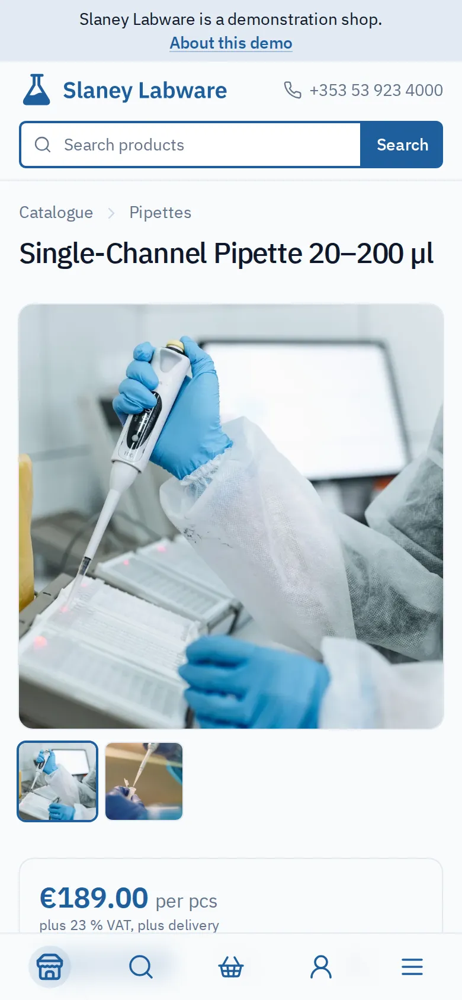

# b2b-catalog-platform

A catalog and ordering platform for small wholesale businesses with repeat business customers.
Customers browse at the prices agreed for them and send order requests that a manager answers.
The catalog, the customers and the orders are maintained in the admin panel or handed to the
shop's ERP, one area at a time.

> **Status:** built for a real client, whose shop is not live yet: the platform is ready and
> the client is reviewing its catalog. What each release changed is in the
> [release notes](https://github.com/vik-koch/b2b-catalog-platform/releases), the order of
> delivery in the [roadmap](docs/roadmap.md).

## Live demo

<!-- prettier-ignore -->
| Shop | Language | What it shows |
| --- | --- | --- |
| [Slaney Labware](https://b2b.vikkoch.com) | English | A laboratory supplier selling to companies only; catalog, customers and orders owned by a simulated back office |
| [Coffee Kontor](https://b2b-dev.vikkoch.com) | German | A coffee roastery selling to businesses and private buyers; everything maintained in the admin panel |

Both shops are fictional, and no mail leaves them. To sign in as a customer on Slaney Labware,
use `purchasing@brennan-biologics.example` and `demo-slaney-2014`. The account is on a customer
tier, so some prices differ from a guest's. Placed orders are answered by the simulated back
office on a regular basis. Staff access and the mail sink are available
[on request](https://github.com/vik-koch).

  
  

More screenshots are in [docs/features.md](docs/features.md).

## Why this project exists

**The client** is a regional wholesaler and retailer with 25 years of trading and about 20
staff, supplying businesses, institutions and retail buyers with high-turnover everyday
consumables. Its catalog of about 1,500 products is a few uniform kinds that vary in size and
format. Repeat customers buy at negotiated prices, and the catalog is kept in the company's
ERP. What it needed is not a typical online shop:

- registration approved by staff, with a price group the customer never sees
- an order request that a manager answers, since prices, quantities and delivery are often
  agreed by phone
- sale by the piece, pack or box, with minimum quantities
- the catalog fed from the ERP, with descriptions, pictures and documents added in the shop
- cheap to run, for a company without an IT department

**Why custom-built.** Shop platforms handle the storefront well, but this B2B core is where
they are weakest: approval and hidden price groups need paid B2B editions or plugins, and an
order a manager answers and an ERP exchange handed over area by area are custom work on any of
them ([comparison](docs/comparison.md)). Built to fit, the whole stack runs on one small VM
with no licence fees.
[ADR 0001](docs/adr/0001-build-custom-instead-of-shop-platform.md) has the concession: without
the portfolio goal, a standard platform with a B2B plugin would be the sane default.

**The platform is half of the solution.** The other half connects it to the client's ERP: an
adapter for the ERP's exchange protocol, an extension inside the ERP, and a business process
the client did not have before — handling online orders in the back office, which I designed
and introduced along with the software. That half is private. This repository holds the
platform's side: the documented machine API the adapter talks to, and a simulated back office
standing in for the ERP on the demo.

**Why it is public.** To show the process along with the result: requirements before code,
decisions recorded with their alternatives, small backward-compatible releases, and
AI-assisted development (see [How it is built](#how-it-is-built)).

## What it does

The full list, linked to the requirements, is in [docs/features.md](docs/features.md).

- **Buyers:** a category tree, attribute filters, search that tolerates typos; their own prices
  per piece, pack or box; stock as in stock / few left / out of stock; a cart kept between
  visits; one-form checkout as a guest or signed in; every order with its history, documents
  and mail.
- **Staff:** registrations to approve and price groups to assign; orders to accept, change by
  agreement and move forward, with every change kept as a version and payment recorded apart;
  a marker whenever something waits for them.
- **Admins:** in-place catalog editing with a publication gate, product documents with expiry
  dates, static pages, maintenance mode, file imports with a preview.
- **A back office:** catalog, customer and order exchanges over a machine API, each handed over
  separately, applying themselves only within set limits, logged, with mail when a feed breaks.
- **Operators:** one image for every shop, configured per deployment in its own language;
  Compose on one VM, CI/CD, logs, alerts, encrypted off-host backups; consent records,
  versioned legal pages and a personal-data inventory.

## Working with a back office

The platform runs on its own, as the German shop does. A shop with an ERP can hand over each
area separately, and an admin can take it back if a feed breaks:

<!-- prettier-ignore -->
| Area | Always the shop's | The back office's, once handed over |
| --- | --- | --- |
| Catalog | pictures, descriptions, attributes, packaging, documents, pairings, publication, the category tree's shape, categories the ERP never named | product names, categories, prices, stock, tax rates |
| Customers | staff accounts, a customer's password, a customer's deletion of their account | approving registrations, price groups, invitations, switching accounts off |
| Orders | placing an order, cancelling one nobody has answered yet | moving and changing orders, recording payment, filing documents |

What the back office fills is read-only in the admin panel while it owns the area. The
differences between the three exchanges are in [docs/exchange-areas.md](docs/exchange-areas.md).

## Built with

<!-- prettier-ignore -->
| Layer | Choice | Decision |
| --- | --- | --- |
| Storefront | Angular with server-side rendering, Tailwind CSS | [0002](docs/adr/0002-angular-nestjs-postgresql-stack.md), [0008](docs/adr/0008-tailwind-owned-primitives-runtime-theming.md) |
| API | NestJS; oRPC + Zod contracts shared by both apps | [0002](docs/adr/0002-angular-nestjs-postgresql-stack.md), [0043](docs/adr/0043-contract-layer-and-what-the-browser-downloads.md) |
| Data | PostgreSQL with Drizzle; search on full-text and trigram indexes | [0030](docs/adr/0030-product-search-postgres-fts-and-trigram.md) |
| Sign-in | App-issued session in an httpOnly cookie, Argon2 hashes | [0019](docs/adr/0019-session-auth-argon2-jwt-cookie.md) |
| Hosting | Docker Compose on one VM, a shared Traefik proxy, Terraform + cloud-init | [0004](docs/adr/0004-docker-compose-on-a-vm.md), [0005](docs/adr/0005-shared-traefik-reverse-proxy.md), [0006](docs/adr/0006-ephemeral-demo-and-manual-pet-vm.md) |
| Operations | Loki + Grafana; backups with an encrypted off-host copy | [0016](docs/adr/0016-central-logs-via-grafana-loki.md), [0067](docs/adr/0067-backups-leave-the-host-as-an-encrypted-pair.md) |
| Workspace | Nx monorepo, TypeScript throughout | [0003](docs/adr/0003-nx-monorepo.md) |

The recurring theme is right-sizing: Postgres search instead of Elasticsearch, Compose instead
of Kubernetes, one proxy instead of an API gateway. How the pieces fit together, with
diagrams, is in [docs/architecture.md](docs/architecture.md).

## Demo and real at once

The client's shop and both demo shops run the same public image, each as its own
[deployment](deployments/README.md): configuration, texts and branding, plus sample content for
a demo. The client's deployment and its adapters live in a private repository that uses only
what this one publishes. The price is that every shop carries every setting and text, features
are more general than one shop needs, and every new text or setting lands in four deployments. In
return, the demos exercise cases one client never would, and the simulated back office is a
working reference client for the machine API. The details are in
[docs/demo-and-real.md](docs/demo-and-real.md).

## Limits

Out of scope on purpose, each with what the platform does instead in
[docs/scope-and-limitations.md](docs/scope-and-limitations.md):

- **Online card payment, for now.** Payment is recorded, never charged.
- **Public article numbers.** Products are identified by their URL; the ERP's key stays
  private.
- **Several categories per product**, and variants with their own price or stock: variants are
  named on pictures.
- **More than one language or currency** per deployment.
- **Tax and shipping calculation.** The shop states its tax basis and delivery rules; a manager
  confirms every order.
- **Company hierarchies and approval chains** inside a customer, reviews, recommendations.

## Documentation

- **The product:** [features](docs/features.md), [limits](docs/scope-and-limitations.md),
  [compared with shop platforms](docs/comparison.md),
  [requirements](docs/requirements.md) with
  stable IDs, the [roadmap](docs/roadmap.md) of iterations and why they came in that order
- **How it behaves:** [the life of an order](docs/order-lifecycle.md),
  [the life of an account](docs/account-lifecycle.md), [every mail](docs/mail.md),
  [the personal data it holds](docs/personal-data.md)
- **Integrating a back office:** [the three exchanges compared](docs/exchange-areas.md); what
  each does ([catalog](docs/catalog-sync.md), [customers](docs/customer-sync.md),
  [orders](docs/order-sync.md)) and its wire-level reference
  ([catalog](docs/catalog-machine-api.md), [customers](docs/customer-machine-api.md),
  [orders](docs/order-machine-api.md))
- **Running a shop:** [deploying a shop](docs/deploying-a-shop.md),
  [configuration reference](deployments/fixture/config/README.md),
  [infrastructure](infra/README.md), [the deployments here](deployments/README.md),
  [demo and real at once](docs/demo-and-real.md)
- **Working on the code:** [running it locally, checks and generated files](docs/development.md),
  [the design language](docs/design-language.md): how colours are named and the contrast they
  keep
- **Architecture:** [how it fits together](docs/architecture.md), and the
  [decision records](docs/adr/README.md), each with the alternatives considered and what the
  choice costs

## How it is built

- **Requirements first.** Every behaviour is a requirement with a stable ID, an iteration
  delivers a set of them, and a decision that shapes the code gets an ADR. Iterations are
  GitHub Milestones; releases have release notes.
- **Trunk-based.** Short-lived branches into `main` behind a pull request and green CI. A merge
  deploys the German shop, a release tag the English one.
- **Versions say what a release asks of an operator**
  ([ADR 0044](docs/adr/0044-versioning-by-what-a-release-changes.md)): a major needs work
  outside the image, a minor adds features, a patch fixes or completes the last minor.
- **Written by AI, decided and reviewed by me.** Every line of code, test and document was
  written by Anthropic's Claude models in Claude Code, across several model generations. I
  wrote the requirements, made the design decisions and reviewed every change before
  committing it, so the commits carry my name as the one who accepted them, not the one who
  typed them.

## License

[MIT](LICENSE.md)
