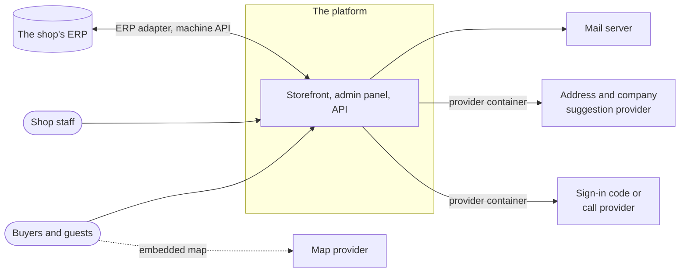
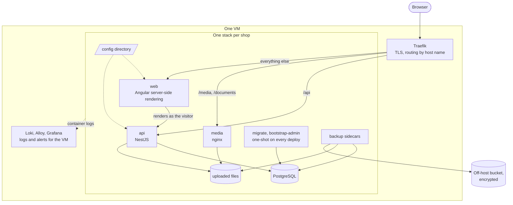
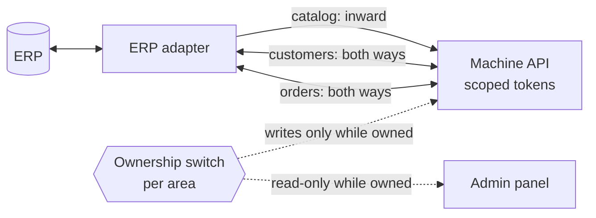
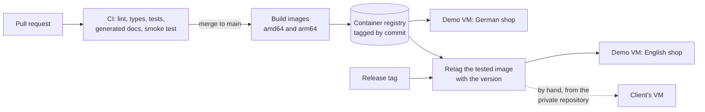

# Architecture

How the platform is put together, from the outside in. The recurring theme is right-sizing: a
shop of a few thousand products and a few hundred customers on one VM, with every component
chosen to be the smallest that does the job. Each section links the decision records behind
it; [docs/adr/](adr/README.md) has all of them in order.

## The shop and its neighbours

Buyers and staff use the same web application; staff see the admin panel inside it. Everything
the shop exchanges with another system goes through a port: mail over SMTP, suggestions and
sign-in codes through a small provider container beside the stack, the ERP through the
documented machine API. The map is an iframe the visitor's browser loads directly
([ADR 0010](adr/0010-map-embedding-iframe-url-only.md)). Only the ports are public; the
adapters for a particular provider belong to the deployment that uses them.

## Inside one stack

- **One Traefik per VM** terminates TLS with Let's Encrypt and routes each stack by host name,
  so several shops share a VM without port juggling
  ([ADR 0005](adr/0005-shared-traefik-reverse-proxy.md)).
- **The web container renders every page on the server**, catalog and static pages alike, so
  the first HTML holds the full content for search engines. It calls the API on the stack's
  internal network with the visitor's own session, and hands what it fetched to the browser so
  the page does not fetch it again.
- **The API** holds all business rules, authorization and rate limiting
  ([ADR 0015](adr/0015-rate-limit-throttler-honeypot.md)). Sessions are an app-issued token in
  an httpOnly cookie, and every request's permissions are read from the database
  ([ADR 0019](adr/0019-session-auth-argon2-jwt-cookie.md)).
- **Uploaded pictures and documents** are written by the API and served by nginx, stored as
  uploaded ([ADR 0021](adr/0021-media-uploads-behind-a-store-port.md),
  [ADR 0048](adr/0048-store-product-documents-unmodified.md)).
- **The config directory** is mounted read-only into both apps and loaded whole at boot: the
  shop's facts, switches, texts and branding
  ([ADR 0018](adr/0018-unified-deployment-config-directory.md)).
- **Migrations run in a one-shot container** from the API image before the new apps start, and
  the same deploy creates the first admin if it does not exist yet
  ([ADR 0012](adr/0012-migrations-one-shot-container.md)).
- **Backups** are a nightly database dump and a paired archive of the uploaded files, encrypted
  and copied to an S3-compatible bucket off the host
  ([ADR 0017](adr/0017-scheduled-database-backups.md),
  [ADR 0067](adr/0067-backups-leave-the-host-as-an-encrypted-pair.md)).
- **Logs** from every container go to one Loki per VM, with Grafana alerts by mail
  ([ADR 0016](adr/0016-central-logs-via-grafana-loki.md)).

Search runs in PostgreSQL itself, on full-text and trigram indexes
([ADR 0030](adr/0030-product-search-postgres-fts-and-trigram.md)); there is no search engine,
cache or queue to run beside it.

## The code

One Nx monorepo, TypeScript throughout ([ADR 0003](adr/0003-nx-monorepo.md)):

<!-- prettier-ignore -->
| Project | What it is |
| --- | --- |
| `apps/web` | Angular storefront, account pages and admin panel, rendered on the server |
| `apps/api` | NestJS API: catalog, accounts, orders, the exchanges, mail and PDFs |
| `libs/shared` | The API contracts and everything both apps read: config schemas, shared constants and rules |
| `libs/seed` | Loads a seed bundle into an empty database |
| `apps/seeder` | The one-shot that runs `libs/seed` on a demo stack |
| `apps/erp-sim` | The simulated back office for the English demo shop |
| `apps/api-e2e`, `apps/web-e2e` | End-to-end suites against a running stack |

**One contract per endpoint.** Each API route is a Zod schema in `libs/shared`, implemented by
the API with oRPC and called by the web app through a typed client, so the two apps cannot
disagree about a request's shape. The browser receives generated route metadata rather than
the schemas, which keeps the validation library out of the first page load
([ADR 0043](adr/0043-contract-layer-and-what-the-browser-downloads.md)). Refusals travel as a
code in the contract, never as a message to match on.

**The database** is PostgreSQL with Drizzle. A few modelling rules carry most of the domain:

- A role (admin, manager, customer) grants permissions; a customer's tier picks the price
  list. The two never mix ([ADR 0031](adr/0031-customer-tiers-and-price-lists.md)).
- A price is a row for a product on a price list, and always per piece
  ([ADR 0058](adr/0058-the-price-is-per-piece.md),
  [ADR 0059](adr/0059-a-price-belongs-to-a-product-and-a-price-list.md)). A unit only reads a
  piece count ([ADR 0042](adr/0042-a-unit-is-a-lens-on-a-piece-count.md)).
- An order is a thread of versions: every move and every change writes one, so an order is its
  own history ([ADR 0051](adr/0051-an-order-is-a-thread-of-versions.md)). Payment is a fact
  beside the state, not a state ([ADR 0050](adr/0050-order-lifecycle-and-payment-as-separate-facts.md)).
- Work awaiting attention is a query over current state, never a table of notifications
  ([ADR 0046](adr/0046-work-awaiting-attention-is-a-query-not-a-table.md)).
- Nothing about a person is erased in place: an account is anonymized, and its orders stay
  ([ADR 0032](adr/0032-account-lifecycle-and-staff-approval.md)).

## Ports

<!-- prettier-ignore -->
| Port | What plugs in | This repository ships | Decision |
| --- | --- | --- | --- |
| Mail | any SMTP server | the SMTP adapter, and Mailpit for the demos | [0013](adr/0013-email-via-mailer-port-smtp-adapter.md) |
| Address and company suggestions | a provider container on the stack network | the HTTP contract only | [0040](adr/0040-address-suggestion-and-delivery-zone-rules.md), [0041](adr/0041-company-identification-and-party-suggestion.md) |
| Sign-in code or call | a provider container on the stack network | the HTTP contract, and mail as the stand-in | [0066](adr/0066-confirm-a-sign-in-through-the-phone.md) |
| Map | an embed URL per office | the configuration key | [0010](adr/0010-map-embedding-iframe-url-only.md) |
| Uploaded files | a media store | the local volume | [0021](adr/0021-media-uploads-behind-a-store-port.md) |
| Back office | an adapter that speaks the ERP's protocol | the machine API, and the simulated back office as a reference client | [0053](adr/0053-machine-tokens-for-automated-clients.md), [0054](adr/0054-source-system-exchange-as-an-inbound-adapter.md) |

## The back-office exchange

Each of the three areas is handed to the back office separately, and an admin can take it
back. While an area is owned, the admin panel's side of it is read-only; while it is not, the
machine API refuses writes to it. Catalog and customer runs whose effect exceeds the
deployment's limits wait for a person; order runs apply or are refused. The adapter runs as a
container on the stack's own network, so the machine token never leaves the host
([ADR 0056](adr/0056-an-external-owner-makes-fields-read-only.md),
[ADR 0060](adr/0060-the-exchange-is-area-scoped.md)). The three areas are compared in
[exchange-areas.md](exchange-areas.md).

## From commit to shop

An image is built once, on the merge, and a release retags that same image rather than
rebuilding it, so what runs in production is byte for byte what ran on dev
([ADR 0007](adr/0007-build-once-promote-multi-arch-images.md)). Each architecture is built on
a native runner. The VM itself is plain Ubuntu with Docker, set up by cloud-init; Terraform
only creates short-lived demo VMs ([ADR 0004](adr/0004-docker-compose-on-a-vm.md),
[ADR 0006](adr/0006-ephemeral-demo-and-manual-pet-vm.md)). A deploy restarts the single
instance, briefly; rolling back is deploying the earlier version
([infra/README.md](../infra/README.md#what-a-deploy-costs-and-how-to-undo-it)). A release's
version says what it asks of the operator
([ADR 0044](adr/0044-versioning-by-what-a-release-changes.md)).

## Decisions by area

<!-- prettier-ignore -->
| Area | Decisions |
| --- | --- |
| Product and stack | [0001](adr/0001-build-custom-instead-of-shop-platform.md), [0002](adr/0002-angular-nestjs-postgresql-stack.md), [0003](adr/0003-nx-monorepo.md), [0043](adr/0043-contract-layer-and-what-the-browser-downloads.md) |
| Hosting and operations | [0004](adr/0004-docker-compose-on-a-vm.md), [0005](adr/0005-shared-traefik-reverse-proxy.md), [0006](adr/0006-ephemeral-demo-and-manual-pet-vm.md), [0007](adr/0007-build-once-promote-multi-arch-images.md), [0012](adr/0012-migrations-one-shot-container.md), [0016](adr/0016-central-logs-via-grafana-loki.md), [0017](adr/0017-scheduled-database-backups.md), [0023](adr/0023-maintenance-mode-db-flag-503-gate.md), [0028](adr/0028-media-backups-and-operator-restore.md), [0044](adr/0044-versioning-by-what-a-release-changes.md), [0067](adr/0067-backups-leave-the-host-as-an-encrypted-pair.md), [0068](adr/0068-simulate-the-demo-back-office-through-the-machine-api.md) |
| Configuration and presentation | [0008](adr/0008-tailwind-owned-primitives-runtime-theming.md), [0009](adr/0009-deployment-config-and-text-via-transfer-state.md), [0010](adr/0010-map-embedding-iframe-url-only.md), [0018](adr/0018-unified-deployment-config-directory.md), [0020](adr/0020-rich-text-as-sanitized-html-tiptap.md), [0024](adr/0024-seo-sitemap-robots-and-environment-indexability.md), [0027](adr/0027-fixed-page-set-with-per-deployment-publication.md) |
| Catalog | [0021](adr/0021-media-uploads-behind-a-store-port.md), [0022](adr/0022-catalog-storage-model-and-import-read-decoupling.md), [0025](adr/0025-catalog-editing-model-and-affordances.md), [0030](adr/0030-product-search-postgres-fts-and-trigram.md), [0036](adr/0036-product-publication-gate.md), [0037](adr/0037-product-attributes-as-rows.md), [0045](adr/0045-availability-as-a-derived-state-of-a-piece-count.md), [0047](adr/0047-pair-products-mutually-and-check-the-cart.md), [0048](adr/0048-store-product-documents-unmodified.md), [0049](adr/0049-documents-expire-not-superseded.md), [0063](adr/0063-a-category-is-a-chip.md), [0064](adr/0064-a-variant-is-a-name-on-a-picture.md) |
| Prices and units | [0031](adr/0031-customer-tiers-and-price-lists.md), [0035](adr/0035-units-of-sale-and-price-basis.md), [0042](adr/0042-a-unit-is-a-lens-on-a-piece-count.md), [0058](adr/0058-the-price-is-per-piece.md), [0059](adr/0059-a-price-belongs-to-a-product-and-a-price-list.md), [0065](adr/0065-state-the-tax-basis-never-the-tax.md) |
| Accounts and security | [0015](adr/0015-rate-limit-throttler-honeypot.md), [0019](adr/0019-session-auth-argon2-jwt-cookie.md), [0032](adr/0032-account-lifecycle-and-staff-approval.md), [0034](adr/0034-password-links-and-password-rules.md), [0066](adr/0066-confirm-a-sign-in-through-the-phone.md) |
| Cart, checkout and orders | [0038](adr/0038-browser-held-cart-and-order-snapshots.md), [0039](adr/0039-one-checkout-form-and-the-ordering-party.md), [0040](adr/0040-address-suggestion-and-delivery-zone-rules.md), [0041](adr/0041-company-identification-and-party-suggestion.md), [0050](adr/0050-order-lifecycle-and-payment-as-separate-facts.md), [0051](adr/0051-an-order-is-a-thread-of-versions.md), [0052](adr/0052-order-documents-generated-or-supplied.md) |
| Mail and notifications | [0013](adr/0013-email-via-mailer-port-smtp-adapter.md), [0014](adr/0014-configurable-email-templates.md), [0033](adr/0033-branded-email-layout-and-templates.md), [0046](adr/0046-work-awaiting-attention-is-a-query-not-a-table.md), [0057](adr/0057-exchange-notifications-are-state-changes.md) |
| Back-office exchange | [0026](adr/0026-catalog-bulk-sync-import-contract-and-run-model.md), [0053](adr/0053-machine-tokens-for-automated-clients.md), [0054](adr/0054-source-system-exchange-as-an-inbound-adapter.md), [0055](adr/0055-when-an-automated-run-applies-itself.md), [0056](adr/0056-an-external-owner-makes-fields-read-only.md), [0060](adr/0060-the-exchange-is-area-scoped.md), [0061](adr/0061-the-exchange-issues-no-credential-and-never-deletes.md), [0062](adr/0062-an-order-write-back-is-one-version.md) |
| Compliance | [0011](adr/0011-cookie-consent-mechanism.md), [0029](adr/0029-third-party-license-attribution-and-policy-gate.md) |
