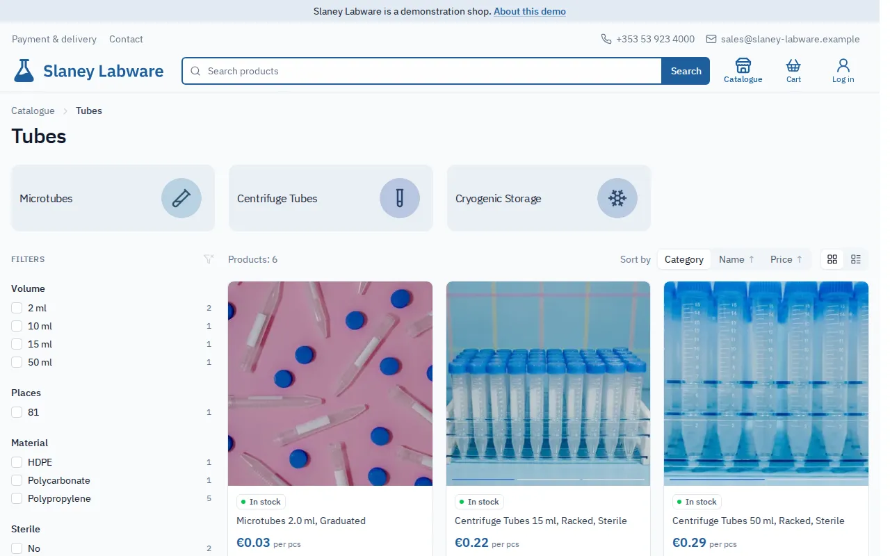
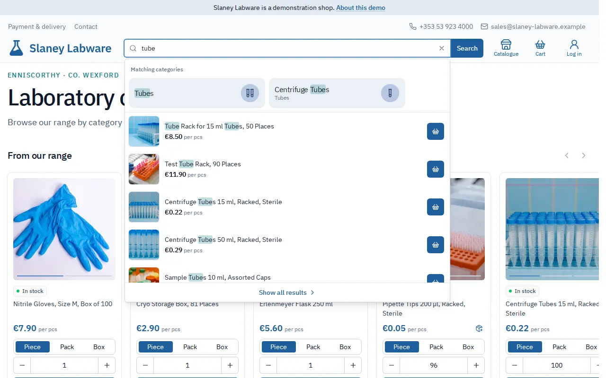
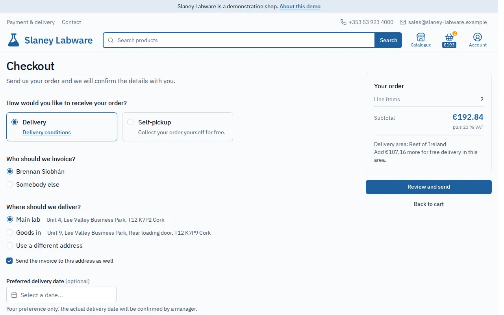
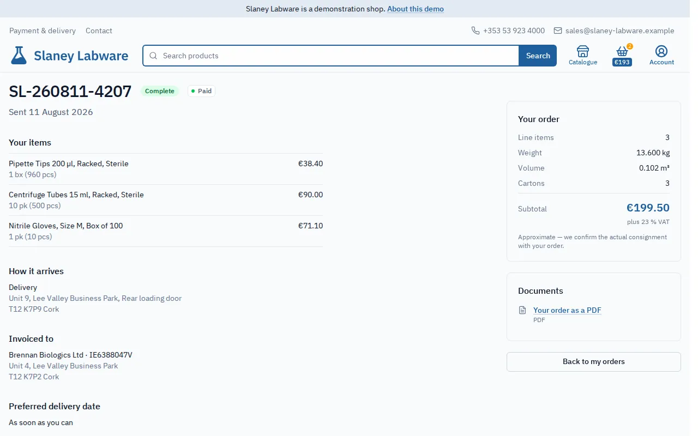
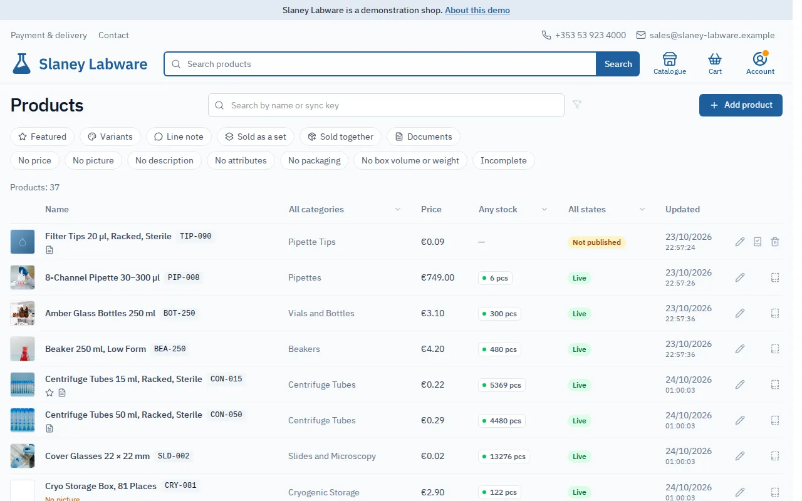
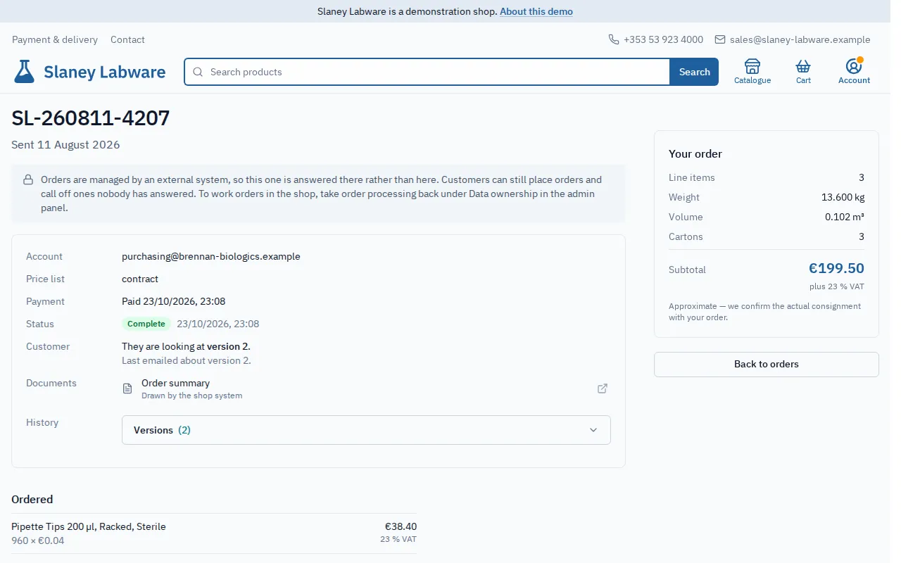
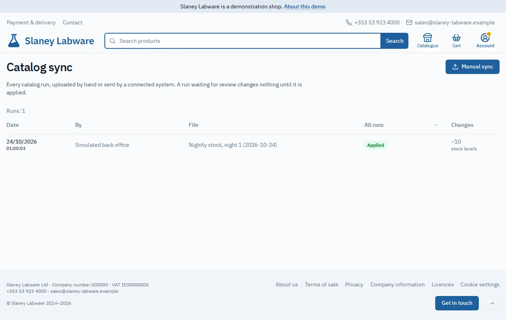
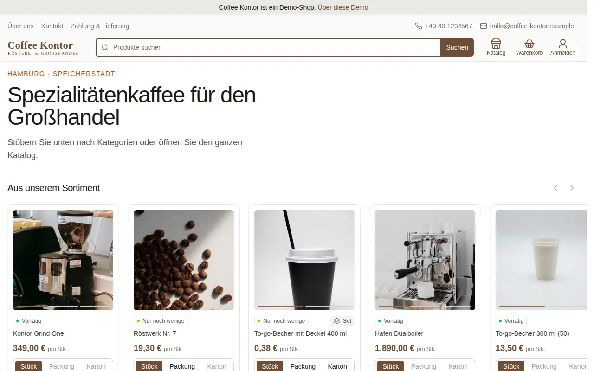
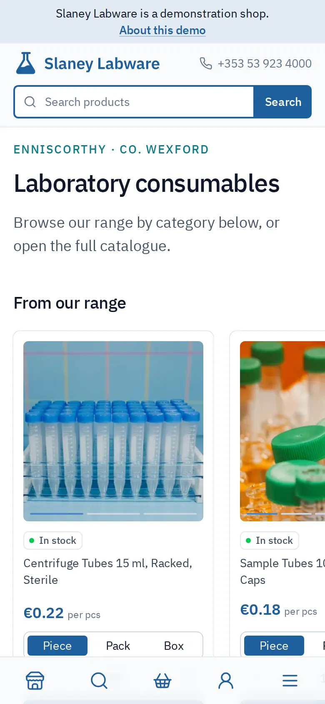
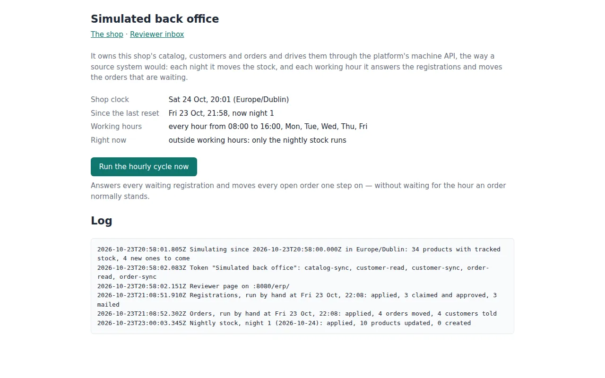

# Features

What the platform does as of the current release, grouped by the part of the shop it belongs
to. Each item links the requirements that define it in [`requirements.md`](requirements.md).
What it deliberately does not do is in [scope-and-limitations.md](scope-and-limitations.md).

**Contents** — [Browsing the catalog](#browsing-the-catalog) ·
[Prices and units](#prices-and-units) · [Accounts](#accounts) ·
[Cart and checkout](#cart-and-checkout) · [Orders](#orders) ·
[Running the shop](#running-the-shop) ·
[Working with a back office](#working-with-a-back-office) ·
[Compliance and privacy](#compliance-and-privacy) · [Platform](#platform) ·
[Demo only](#demo-only) · [Planned](#planned)

---

## Browsing the catalog

- **Category tree** — every product belongs to exactly one category in a tree. A
  category appears as a chip with an optional square mark beside its name, and its counts
  include its whole subtree.
  [FR-CAT-02](requirements.md#fr-cat-02), [FR-CAT-07](requirements.md#fr-cat-07),
  [FR-ADM-19](requirements.md#fr-adm-19)
- **Main page** — the category overview plus a featured row: the products an admin marks as
  featured first, topped up at random, never anything out of stock.
  [FR-CAT-01](requirements.md#fr-cat-01), [FR-CAT-09](requirements.md#fr-cat-09)
- **Listings** — paginated, as cards or as rows; the visitor's choice is remembered.
  Products that are out of stock move to the end of every listing.
  [FR-CAT-03](requirements.md#fr-cat-03), [FR-CAT-06](requirements.md#fr-cat-06),
  [FR-STOCK-05](requirements.md#fr-stock-05)
- **Product page** — gallery, description, attribute table, packaging, prices per unit,
  documents, and the products it is sold together with.
  [FR-CAT-05](requirements.md#fr-cat-05)
- **Search** — ranked full-text search on product names with typo tolerance, sort controls,
  and shareable URLs. Type-ahead suggestions show a picture and the viewer's own price, can
  put a product straight into the cart, and list matching categories as their own group. A
  query typed on the wrong keyboard layout is still understood.
  [FR-SEARCH-01…08](requirements.md#fr-search)
- **Attribute filters** — an admin declares which attributes are filterable; each category
  picks the ones its listing offers. Filters show counts, combine predictably, live in the
  URL, and grey out subcategories the current selection leaves empty. The catalogue index
  has a filter panel of its own.
  [FR-ATTR-01…13](requirements.md#fr-attr)
- **Stock availability** — an optional piece count, shown to customers only as _in stock_,
  _few left_ or _out of stock_. What is out of stock cannot be ordered.
  [FR-STOCK-01…05](requirements.md#fr-stock)
- **Variants on pictures** — an assorted article names its variants (colours, designs) on its
  pictures; a variant that runs out is marked unavailable rather than removed. The customer
  states their choice in a note on the cart line.
  [FR-CAT-11…13](requirements.md#fr-cat-11), [FR-CART-08](requirements.md#fr-cart-08)
- **Sets of parts** — a product sold as a set (a cup and its lid) is filtered by the
  attributes of each part. [FR-CAT-10](requirements.md#fr-cat-10)
- **Product documents** — certificates, declarations and data sheets, uploaded once and
  linked to any number of products, or a link to where the document is held elsewhere, such
  as a public register. A document is stored exactly as uploaded and leaves the storefront
  the day it expires. [FR-DOC-01…05](requirements.md#fr-doc)

Screenshots

## Prices and units

- **Price lists per customer group** — a product has a price on each price list. Customer
  tiers map to price lists. Guests and customers without a tier see the list marked as the
  default. A customer never sees which tier they are in.
  [FR-AUTH-05](requirements.md#fr-auth-05)
- **Piece, pack and box** — a price is per piece. A product can be bought by the piece, the
  pack or the box, with a minimum order quantity. Each unit shows its exact price, and totals
  are never rounded. Packaging facts (sizes, volume, weight, how many boxes a product ships
  as) give any cart a shipment estimate.
  [FR-UNIT-01…11](requirements.md#fr-unit)
- **Tax basis** — the shop states whether its prices include tax, exclude it, or carry none,
  with a rate per product where it differs from the default. The platform states the basis;
  it never calculates tax. [NFR-LEGAL-11](requirements.md#nfr-legal-11)

## Accounts

- **Three roles** — admin, manager and customer. A role grants permissions and is
  independent of the customer's price group. [FR-AUTH-03](requirements.md#fr-auth-03)
- **Registration with approval** — a customer registers (with suggestions for the company
  name and number where a provider is configured), staff approve or decline, assign a tier,
  and the customer receives a link to choose a password. Staff can also invite a customer
  directly. [FR-AUTH-01](requirements.md#fr-auth-01), [FR-AUTH-04](requirements.md#fr-auth-04),
  [FR-AUTH-09](requirements.md#fr-auth-09), [FR-AUTH-11](requirements.md#fr-auth-11)
- **Customer kinds** — a deployment sells to companies, private persons or both, and that
  rule holds everywhere an account or an order is written.
  [FR-AUTH-13](requirements.md#fr-auth-13)
- **Self-service** — profile, password change and reset, an address book, and the customer's
  orders with their status. [FR-AUTH-02](requirements.md#fr-auth-02),
  [FR-AUTH-08](requirements.md#fr-auth-08), [FR-AUTH-10](requirements.md#fr-auth-10),
  [FR-ACC-01](requirements.md#fr-acc-01)
- **Optional second sign-in step** — a code by text message or a confirmation call to the
  account's phone, with a remembered browser.
  [FR-AUTH-12](requirements.md#fr-auth-12)
- **Account deletion** — a customer can delete their own account, and an admin can do it on
  their request. The account is anonymized rather than erased, so the shop's past orders keep
  their records. [FR-AUTH-06](requirements.md#fr-auth-06),
  [FR-ADM-23](requirements.md#fr-adm-23)

## Cart and checkout

- **Cart** — kept in the browser between visits. On return it says once what changed while
  it waited: prices, availability, quantities.
  [FR-CART-01](requirements.md#fr-cart-01), [FR-CART-02](requirements.md#fr-cart-02),
  [FR-CART-10](requirements.md#fr-cart-10)
- **Sold-together products** — an admin pairs products that are sold together, such as a
  vial and its caps. The pairing is marked wherever the product can be bought, its
  counterparts can be added without leaving the page, and the cart says what is missing.
  This is advisory, or enforced at checkout where the deployment says so.
  [FR-SET-01…05](requirements.md#fr-set)
- **One-form checkout** — as a guest or signed in. It sends an order **request** for a
  manager to answer; nothing is charged at checkout.
  [FR-CART-03](requirements.md#fr-cart-03), [FR-CART-04](requirements.md#fr-cart-04)
- **Who is invoiced** — the customer's own company, another company or another person, held
  apart from the delivery address. A third-party order is priced provisionally.
  [FR-CART-09](requirements.md#fr-cart-09)
- **Delivery or pickup** — delivery zones with their own rules and free-delivery thresholds,
  or a choice of pickup points, a preferred date, and address suggestions where a provider is
  configured. [FR-CART-07](requirements.md#fr-cart-07),
  [FR-CART-11](requirements.md#fr-cart-11)
- **Payment methods** — cash on delivery or pickup, bank transfer, or card arranged with the
  shop, offered according to who is invoiced: a company is invoiced, so it pays by transfer.
  [FR-CART-04](requirements.md#fr-cart-04)

Screenshot

## Orders

- **Order processing** — a manager accepts or declines an order, moves it forward (accepted,
  ready, completed), or one step back after a wrong click. The customer can cancel while
  nobody has answered. Orders are never deleted.
  [FR-ORD-01](requirements.md#fr-ord-01), [FR-ORD-02](requirements.md#fr-ord-02)
- **Changes by agreement** — lines, quantities, prices, the price list the order is priced
  from, delivery, the invoiced party and the payment method. Every move and every change
  writes a version: the order is its own history, any version reads back whole, and the
  reference and link stay the same. [FR-ORD-03](requirements.md#fr-ord-03)
- **Payment beside the state** — the platform records whether an order is unpaid or paid; it
  never moves money. An order handed over that nobody recorded as paid is counted as work.
  [FR-ORD-04](requirements.md#fr-ord-04)
- **Order documents** — payment instructions and an order summary, generated by the platform
  or replaced by the shop's own file, attached to the acceptance mail.
  [FR-ORD-05](requirements.md#fr-ord-05), [FR-ACC-02](requirements.md#fr-acc-02)
- **Mail** — receipt to the customer and a notice to the shop for every order, and an
  optional mail for every move or change that carries what changed since the last one. Every
  message is listed in the [mail gallery](mail.md); the whole flow is in
  [the life of an order](order-lifecycle.md).
  [FR-NOTIF-01…08](requirements.md#fr-notif)

Screenshot

## Running the shop

- **Catalog editing** — products and categories edited in place where they appear, with
  pictures (framed before upload), attributes with suggestions, packaging and documents.
  [FR-ADM-01](requirements.md#fr-adm-01)
- **Publication gate** — a new product stays unpublished until someone reviews it, and one
  without a price cannot be published. [FR-ADM-06](requirements.md#fr-adm-06)
- **Admin product list** — searchable, and filterable by what a product lacks or carries, with
  each row naming its gaps. [FR-ADM-05](requirements.md#fr-adm-05),
  [FR-ADM-20](requirements.md#fr-adm-20)
- **Removing a product in steps** — unpublish, delete, then delete permanently; deleted
  products are kept out of every count. [FR-ADM-21](requirements.md#fr-adm-21),
  [FR-ADM-22](requirements.md#fr-adm-22)
- **Static pages** — about, conditions, terms, privacy, imprint, withdrawal and the
  contact text are edited
  in the admin as rich text. Each deployment chooses which ones it publishes. The conditions
  page states what checkout actually offers, read from the same configuration.
  [FR-ADM-03](requirements.md#fr-adm-03), [FR-NAV-01…06](requirements.md#fr-nav)
- **Work awaiting attention** — a marker on the account control whenever a queue has
  something in it (registrations, unpublished or unpriced products, expiring documents,
  unanswered or unpaid orders), with each count linking to its section. Counts come from
  current state and clear only when the work is done.
  [FR-WORK-01…04](requirements.md#fr-work)
- **Maintenance mode and a site notice** — the storefront can be closed while the admin stays
  open, and a deployment can show a line above every page and mail, such as "closed over the
  holidays". [FR-ADM-04](requirements.md#fr-adm-04), [FR-NAV-08](requirements.md#fr-nav-08)
- **Links elsewhere** — the shop's social accounts, messengers or marketplace shops in the
  footer. [FR-NAV-07](requirements.md#fr-nav-07)

Screenshot

## Working with a back office

The platform runs on its own, with everything entered in the admin. It can also hand three
areas to an external system such as an ERP, one area at a time. The three exchanges are
compared in [exchange-areas.md](exchange-areas.md).

- **Catalog** — a file upload with a diff preview before anything is applied, or the same
  import driven by a machine. The back office sends names, categories, prices, stock and tax
  rates. The shop keeps what it presents: pictures, descriptions, attributes, publication and
  the shape of the category tree. [FR-ADM-02](requirements.md#fr-adm-02),
  [FR-ADM-07](requirements.md#fr-adm-07) — [catalog-sync.md](catalog-sync.md),
  [catalog-machine-api.md](catalog-machine-api.md)
- **Customers** — the back office can invite, approve, decline, assign a tier, switch an
  account off and on, and read every account out, including those registered on the website.
  It never sets a password and never deletes anyone. An account registered on the shop can be
  claimed by the back office once. [FR-ADM-11…18](requirements.md#fr-adm-11) —
  [customer-sync.md](customer-sync.md), [customer-machine-api.md](customer-machine-api.md)
- **Orders** — the back office reads orders out and writes back what it did: a move, an
  agreed change and the payment, recorded together as one version. It can file the shop's
  real invoice as a file. Placing an order, and cancelling one nobody has answered yet,
  always stay with the customer. [FR-ADM-08](requirements.md#fr-adm-08) —
  [order-sync.md](order-sync.md), [order-machine-api.md](order-machine-api.md)
- **Ownership switch** — an admin hands an area over without a deploy, and takes it back when
  a feed breaks. While an area is handed over, the fields it fills are read-only in the admin.
  [FR-ADM-10](requirements.md#fr-adm-10)
- **Safe by default** — machine tokens scoped per area; a policy that applies a run on its own
  only when its effect stays within set limits, and otherwise holds it for a person; an
  instruction that repeats itself changes nothing; a log of every run; mail to the admin when
  a feed breaks, recovers or waits for a decision.
  [FR-ADM-09](requirements.md#fr-adm-09), [FR-ADM-16](requirements.md#fr-adm-16),
  [FR-NOTIF-09](requirements.md#fr-notif-09), [NFR-SEC-09](requirements.md#nfr-sec-09)

Screenshots

## Compliance and privacy

- **Legal pages with versions** — every version of a page is kept, and the ones a reader may
  hold the shop to are dated. [NFR-LEGAL-01](requirements.md#nfr-legal-01),
  [NFR-LEGAL-02](requirements.md#nfr-legal-02)
- **Consent** — per purpose, switched on per deployment, recorded against the text it was given
  under, with withdrawals and an admin lookup by account, email or phone.
  [NFR-LEGAL-09](requirements.md#nfr-legal-09)
- **Terms of sale** — an order accepts the terms by version, and they are sent with the receipt
  where a jurisdiction wants them kept. [NFR-LEGAL-10](requirements.md#nfr-legal-10)
- **Personal data** — an inventory of everything the platform holds
  ([personal-data.md](personal-data.md)), finished orders that lose their personal details after
  a set period, and a record of every destruction of personal data.
  [NFR-LEGAL-12…14](requirements.md#nfr-legal-12)
- **The rest** — cookie consent, a withdrawal notice, a seller line in the footer, and a page of
  third-party licences. [NFR-LEGAL](requirements.md#nfr-legal)

## Platform

- **Mobile-first where it counts** — every storefront, account and admin view works on a phone,
  with a bottom tab bar and a search overlay on narrow screens.
  [NFR-SEO-03](requirements.md#nfr-seo-03)
- **Search-engine friendly** — server-side rendering with full content in the first HTML, a
  sitemap and robots.txt, and listing variants kept out of the index.
  [NFR-SEO-01…04](requirements.md#nfr-seo)
- **Security** — HTTPS everywhere, hashed passwords, server-side access control, validated
  request payloads, rate limits on sign-in, orders and search, and credentials kept out of logs.
  [NFR-SEC-01…10](requirements.md#nfr-sec)
- **Operations** — CI/CD to separate dev and prod stacks, central logs with alerts, scheduled
  backups with an encrypted copy off the host, and releases with bounded downtime.
  [NFR-OPS-01…07](requirements.md#nfr-ops)
- **One deployment, one language** — every text, page and mail comes from the deployment's own
  configuration, so a shop runs in any single language without a code change.

Screenshots

## Demo only

- **Simulated back office** — on the English demo shop, a small app owns the catalog, the
  customers and the orders, and drives them through nothing but the public machine API. It
  sells stock down and reorders it nightly, brings in new articles unpublished, and approves
  registrations and moves orders forward hourly in working hours. A page behind the reviewer
  login shows what it did and runs its hourly cycle on request.
  [ADR 0068](adr/0068-simulate-the-demo-back-office-through-the-machine-api.md)

Screenshot

## Planned

- **Online card payment** after an order is accepted. Unscheduled: it needs a merchant account
  and a live order flow to design against. Until then, a card payment arranged with the
  manager is a recorded payment method. [FR-CART-06](requirements.md#fr-cart-06)
